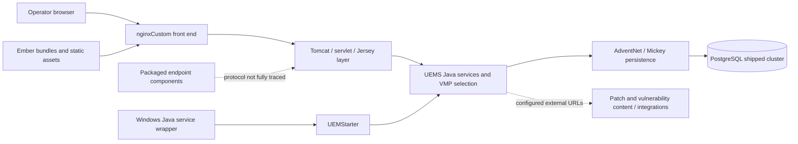
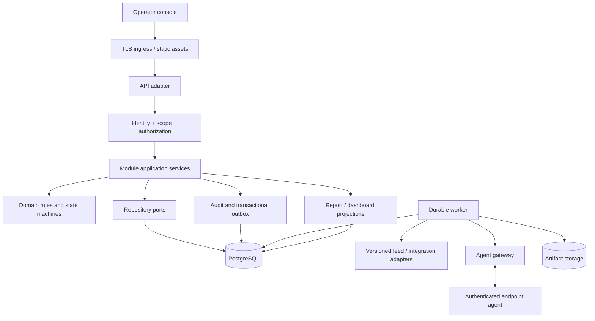

# VMP reconstruction: system architecture

**Revision:** 0.1 • **Date:** 2026-10-29 • **Status:** evidence-based design baseline, not production certification

## 1. Purpose and scope

Design a maintainable vulnerability-management platform informed by the supplied ManageEngine Vulnerability Manager Plus installer, build 11.5.2640.04. The deliverable separates the **observed original system**, the **proposed replacement**, and the **implemented development skeleton**. These are different things. Recovered artifacts do not prove every original behavior, and the replacement is not yet wire-compatible with original agents or APIs.

The project covers asset inventory, vulnerability assessment results, patch management, configuration assessment, policy/compliance, agent communication, scheduling, dashboards, reporting, integrations, administration, audit and recovery. A module boundary is not a claim that every feature in that module is available in the original VMP edition.

## 2. Evidence baseline

Evidence root: `C:\edr\vmp-reconstruction`. Original installer SHA-256: `A7E73C2405CF2EAF67032E878436B7AAC1D34835E5AEE936EEAD142B9C0E231C`.

| Observation | Source | Limit |
|---|---|---|
| 38,897 extracted files, all hashed | `evidence/server-files.jsonl` | File coverage does not establish feature coverage |
| Java wrapper, UEMStarter, Tomcat and nginxCustom | `ARCHITECTURE.md`; shipped wrapper/web settings | Effective installation/runtime settings unverified |
| Ember clients and 39 lazy engine directories | `UI-FEATURES.md` | Shared-product engines are not all enabled VMP features |
| VMP module map: Patch, Vulnerability, Configurations, SMP | `server/conf/DesktopCentral/configurations/product-module-mapping.json` | Detailed initialization and license conditions unresolved; SMP is preserved as a vendor label |
| PostgreSQL 14.23; 4,967 ordinary tables in shipped desktopcentral DB | `DATABASE.md`; `database-recovery/database-1-relations.json` | This is a shipped database, not customer operational data |
| 220 schema dictionaries; 6,508 table declarations | `evidence/database-schema-inventory.json` | Includes variants, extensions, deprecated/shared declarations |
| 1,211 security URL declarations explicitly include VMP | `evidence/ui-security-routes.json` | Not a count of unique verified endpoints |
| 10 VMP dashboards, 87 card declarations | `evidence/ui-vmp-dashboards.json` | Visibility and interactions depend on roles and editions |

REA evidence IDs, failed operations and semantic limits are recorded in the existing `ANALYSIS.md`. Native backend method behavior, full agent protocols, live UI states and remote feeds remain unresolved.

## 3. Observed original architecture

Solid edges summarize configuration relationships. Dashed edges identify incomplete protocol/runtime analysis. No original production server or endpoint agent was run during the analysis; only a copied database was temporarily started for export.

## 4. Proposed replacement architecture

Use a **modular monolith** for the first implementation. Keep business modules in one service deployment with explicit ownership and application ports. Separate background workers and agent transport from browser request processing. Avoid splitting every module into a network service before workloads or team ownership justify it.

The initial skeleton uses Node.js ES modules and a plain HTML/CSS/JavaScript console without third-party runtime dependencies. This is a proposed implementation choice, not the original Java/Ember stack. PostgreSQL is the proposed production persistence layer. Database drivers, identity integration, durable workers and the final UI framework are not yet selected or installed. The existing client skeleton can later be replaced behind the same API contracts.

Only the API adapter, synthetic repository, count projection and basic console are implemented now. The other boxes are design boundaries with documented acceptance gates.

## 5. Module ownership

| Module | Owns | Collaborates with | Current state |
|---|---|---|---|
| Identity | Principals, roles, permissions, resource scope | All request handlers | Design |
| Assets | Device identity, groups, inventory history | Agents, findings, reports | Synthetic read API |
| Vulnerabilities | Definitions, findings, exceptions, lifecycle | Assets, feeds, policies | Synthetic read API |
| Patches | Applicability, deployment plans/results, rollback policy | Jobs, agents, maintenance windows | Design |
| Configurations | Rules, assessments, approved remediation | Agents, policies, jobs | Design |
| Compliance | Versioned policies and evaluations | Findings, configuration results | Design; original entitlement unresolved |
| Agents | Enrollment, device identity, heartbeat, command protocol | Assets, jobs, settings | Design |
| Jobs | Schedules, leases, retry, cancellation | Domain command handlers | Design |
| Reports | Report definitions, exports, scoped read models | Domain queries, artifacts | Design |
| Integrations | Feed snapshots, connector configurations, sync runs | Findings, patch catalog, secrets | Design |
| Audit | Actor/action/resource/outcome events | Every mutation | Design |
| Settings | Validated settings and secret references | Identity, jobs, integrations | Design |
| Dashboard | Scoped card projections and freshness | Assets, findings, reports | Synthetic count API |
| Recovery | Backup manifests, migrations, restore rehearsals | Persistence and deployment | Design |

Modules expose application services; they do not directly modify other modules' private tables. Read projections may join documented views, but write ownership remains explicit. Shared domain types should remain small: identifiers, time, scope, result/error types and event envelopes.

## 6. Principal workflows

### Assessment ingestion

1. Authenticate the enrolled device and verify payload version, size, signature/transport identity and sequence.
2. Resolve device-to-organization identity server-side; never trust a submitted organization ID alone.
3. Deduplicate by agent, snapshot ID and sequence. Store immutable observation provenance.
4. Normalize inventory and assessment evidence using a versioned feed/rule snapshot.
5. Update findings transactionally, preserving first/last observation and resolution reasons.
6. Commit audit/outbox entries, then refresh projections asynchronously.

### Patch deployment

1. Operator selects scoped assets and approved patches; policy checks applicability, maintenance window and reboot constraints.
2. An approval creates an immutable deployment-plan version and idempotent job request.
3. Worker claims a lease and issues a typed, expiring command to the correct agent.
4. Agent validates identity and artifact digest, executes only the approved action, and returns structured progress/results.
5. Worker records per-device outcomes. Partial success is preserved; retries never silently rerun non-idempotent changes.
6. Rollback is a distinct supported operation, not an assumed capability for every patch.

### Dashboard/report request

Identity and resource scope are applied before aggregation. Cards report refresh time and source status; stale or failed feeds never appear as a healthy zero count. Exports use the same scope rules and expire through an explicit retention policy.

## 7. Data architecture

The proposed normalized schema starts with organization, asset, vulnerability definition, finding, job, outbox and audit records. `infra/database/001-foundation.sql` is a reviewable starting migration, not a full production schema. It does not provide authentication, row-level security or append-only grants yet.

Use composite organization/resource keys for scoped entities. Asset/finding relationships include organization in foreign keys to prevent cross-organization references. Domain IDs are opaque UUIDs. Feed definitions preserve source/version; assessment provenance must survive normalization. Large binary artifacts belong in object/file storage with digest and ownership metadata in PostgreSQL.

Do **not** automatically import the recovered 4,967-table database into the replacement. First map table semantics and module/version ownership. Restore original dumps only into a separate analysis environment. Production migration requires explicit source-to-target mappings, transformations, counts, constraints, reconciliation and rollback.

## 8. API, events and agent boundaries

The current OpenAPI document describes only the new demo contract. It does not claim compatibility with original `/dcapi` endpoints. Future APIs use explicit versions, bounded pagination, stable error codes, request IDs and optimistic concurrency for updates. Mutations require idempotency keys where retries could duplicate effects.

Proposed event envelope: `eventId`, `eventType`, `schemaVersion`, `organizationId`, `aggregateId`, `aggregateVersion`, `occurredAt`, `correlationId`, `payload`. Publish through a transactional outbox; consumers maintain deduplication state. Ordering is guaranteed only within the documented aggregate boundary.

Original agent wire compatibility is a separate research gate. The first simulator uses a new, documented protocol with fixtures. No arbitrary remote-shell API belongs in the foundation. Device actions must be typed, authorized, signed, expiring and auditable.

## 9. Security and trust boundaries

Production requires authenticated operators, server-derived scopes, deny-by-default permissions, protected sessions, CSRF protection where cookie-based sessions apply, rate/body limits, secure enrollment, credential rotation and secret references. Database and worker identities receive only required privileges. Report downloads recheck ownership and authorization.

Separate browser ingress, agent ingress, database access, external connector egress and artifact access. Audit sensitive changes without recording passwords/tokens. Validate patch/feed signatures and hashes before activation. Changes to scanning/remediation policy require explicit authorization and traceable revisions.

The demo has **no authentication** and binds only to loopback. It rejects writes and exposes no real scanning, patch execution or database connection. It must not be deployed publicly.

## 10. Deployment and operations

Initial production target: one API/static deployment, one worker deployment, PostgreSQL, artifact storage and TLS ingress. Scale read replicas, workers or individual modules only after measuring bottlenecks. Define backup retention, RPO/RTO, supported endpoint count and job throughput with the operator before sizing; no numerical capacity claim is validated yet.

Required telemetry: request latency/error rates, authorization denials, job age/lease expiry/retries, agent last-seen age, feed freshness, database saturation, export backlog and backup verification age. Readiness checks dependencies; liveness checks process health. The demo implements liveness only.

Release with reversible schema changes, versioned config, signed artifacts, staged rollout and restore rehearsal. A shutdown stops new job claims, drains bounded requests and releases leases safely. Dependency/feed outage must remain visible rather than clearing findings or fabricating successful execution.

## 11. Decision record and unresolved gates

| Decision | Reason | Revisit when |
|---|---|---|
| Separate evidence and implementation directories | Preserve reproducible recovered artifacts | Never merge mutable app state into evidence |
| Modular monolith first | Makes transaction/module boundaries testable without distributed complexity | Measured scale or independent deployment requirements demand separation |
| Dependency-free runnable demo | Validate project layout and contracts immediately | Production adapters/framework choices are approved and tested |
| PostgreSQL proposed for persistence | Relational workflow/data requirements and recovered DB evidence | Data model and operational requirements suggest otherwise |
| No direct legacy database import | Shared/versioned tables are not yet semantically reconciled | Mapping and restore qualification are complete |
| Explicit 501 for design-only modules | Prevent false feature readiness | Module acceptance gates pass |

Open gates: original runtime observation; role/license matrix; native/Java method analysis; database restore validation; feed acquisition/compatibility; agent protocol and endpoint tests; UI screenshot comparisons; operational sizing; recovery and upgrade tests. The project-wide completeness percentage remains undefined until the feature/state inventory is validated.
