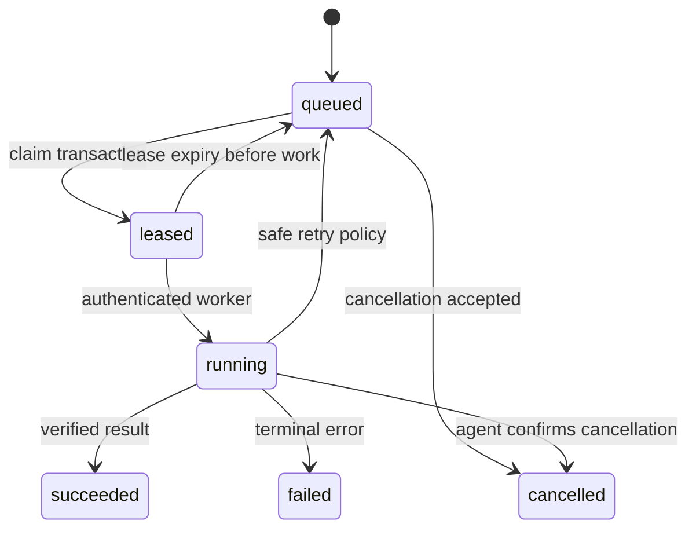

# Technical implementation paper

**Project:** VMP reconstruction platform • **Revision:** 0.1 • **Date:** 2026-10-29

## Abstract

This paper translates the recovered architecture into an incremental implementation plan with concrete boundaries, contracts, data structures, tests and release gates. The supplied product has been unpacked and partially analyzed; the implementation here is a new foundation, not recovered original source. The current artifact runs a read-only synthetic console and API. Production security, persistence, workers, endpoint actions and exact visual parity are outstanding work.

## 1. Inputs and engineering assumptions

Inputs are the analysis report, source-file hash manifest, UI/API declaration inventories, REA evidence bundles and logical PostgreSQL exports under `C:\edr\vmp-reconstruction`. Preserve those files unchanged. All newly authored files live under `C:\edr\vmp-platform`.

Assumptions: first deployment is on-premise; browser operators manage scoped endpoint groups; assessments and deployments are asynchronous; feeds can be stale/unavailable; authorization and device identity are separate concerns. These are proposed requirements to validate, not facts recovered for every original workflow.

Non-goals of version 0.1: install original services, start original agents, execute real patches, import customer credentials, bypass edition/license checks, reproduce all screens, or claim original protocol compatibility.

## 2. Repository structure and dependency rules

```text
vmp-platform/
  apps/
    api/                   HTTP adapter and local entry point
    web/                   Read-only development console
    worker/                Durable worker boundary (design)
    agent-simulator/       Deterministic test-client boundary (design)
  packages/
    domain/                Module catalog and pure dashboard calculation
    adapters/              Synthetic repository
    modules/               Fourteen module specifications
  contracts/openapi.json   Actual skeleton HTTP contract
  infra/database/          Proposed foundation migration, not applied
  docs/                    Architecture and this implementation paper
  scripts/                 Scaffold generation and structural checks
  tests/                   HTTP integration and repository tests
```

HTTP handlers depend on application/domain services and repository ports. Domain rules never import HTTP or concrete database drivers. Production adapters implement repository/connector ports. Frontend code consumes public contracts, not database tables. Worker handlers call application services; they do not bypass permission/policy validation simply because they are asynchronous.

`scripts/scaffold.py` generates module README files, catalog and OpenAPI scaffolding. Edit its source before regenerating these outputs. It does not generate business implementations. The remaining source files are hand-authored.

## 3. Runnable baseline

Requirements: Node.js 24 or later. No npm dependency installation is needed.

```powershell
Set-Location C:\edr\vmp-platform
npm.cmd run check
npm.cmd test
npm.cmd start
# Open http://127.0.0.1:4100
```

Optional port override: `$env:PORT='4101'` before starting. Shutdown with Ctrl+C. The server binds to `127.0.0.1`; it has no production mode. Fixture data is recreated per process and never persisted. No environment secret or original database is required.

Implemented endpoints:

| Method / path | Behavior |
|---|---|
| GET `/health/live` | Process health, demo mode, no persistence, productionReady=false |
| GET `/api/v1/assets` | Two synthetic device records |
| GET `/api/v1/vulnerabilities` | Two explicitly synthetic findings |
| GET `/api/v1/dashboard` | Counts calculated from the same repository |
| GET `/api/v1/modules` | Fourteen module descriptions/statuses |
| GET `/api/v1/capabilities` | Explicit implemented/unimplemented capability flags |
| GET for known design-only module roots | 501 NOT_IMPLEMENTED |
| Any non-GET method | 405 READ_ONLY_SKELETON |
| Unknown paths | 404 without filesystem traversal |

Static files are served through a fixed allowlist. Responses include a request ID for JSON and a restrictive content-security policy. Browser rendering uses textContent rather than interpolating HTML. These are foundation controls, not a complete security review.

## 4. Domain and persistence implementation

### Asset and finding slice

Implement scoped asset list/detail, inventory observations, findings list/detail and dashboard projections first. Define `AssetRepository.list(scope, page, filter)` and `FindingRepository.list(scope, page, filter)` ports. A future `UnitOfWork` owns transaction commit/rollback. The current demo repository intentionally implements only simple fixture accessors; pagination/authorization are not silently simulated.

Finding identity must include the stable asset, definition and evidence identity. Normalize vendor-specific version/file evidence without destroying the original record. Track observation time separately from ingestion time. Preserve unknown severity/applicability rather than interpreting missing values as safe or not affected.

`infra/database/001-foundation.sql` supplies organization, asset, vulnerability_definition, finding, job, outbox and audit_event tables. It includes scoped keys, selected state checks and lookup indexes. It is not applied or integration-tested by the demo. Identity tables, policy schemas, production grants, RLS, outbox claim indexes/leases and immutable audit permissions must be designed before real data is connected.

### Legacy schema reconciliation

1. Restore the original dump into an isolated analysis database and validate it independently.
2. Identify active module/version extensions; do not flatten 6,508 XML declarations into one schema.
3. Map original table/key meanings to replacement entities with source references and confidence.
4. Write bounded extract-transform-load jobs with dry-run counts and rejection reports.
5. Reconcile source/target totals, IDs, null semantics, foreign keys, timestamps and selected field checksums.
6. Keep a migration manifest with source dump hash, mapping version, tool version and results.

No automatic migration of secrets, binary serialized objects or ununderstood vendor state is allowed. Preserve such fields as unresolved evidence until a deliberate mapping exists.

## 5. API and authorization implementation

Production request pipeline: request ID → body/size validation → authentication → organization/resource scope → operation permission → command/query validation → application service → response mapping. Apply scope in SQL predicates as well as service checks. Add negative tests for cross-scope identifiers and report/export paths.

Choose a supported identity provider or a deliberately designed local identity system during the identity phase. Cookie sessions require secure/HTTP-only attributes, CSRF protection and session rotation. Tokens require issuer/audience/expiry verification and revocation policy. Do not promote the unauthenticated demo into production by placing it behind only a cosmetic login page.

Error envelope: `error.code`, `error.message`, `error.requestId`; details may contain safe field-validation errors. Do not send database exceptions, filesystem paths or secret values to clients. Production lists need cursor/limit contracts and stable sorting. Updates need an entity version or conditional request to reject stale changes.

The original API inventory is a research index. For each intended compatibility route, create a separate mapping: original method/path/product conditions → handler → request/response schema → authorization → domain operation → test fixtures. Never assume a matching URL alone establishes compatibility.

## 6. Jobs, events and endpoint execution

Proposed job states:



Every transition checks the lease owner, expiry and version. Record attempts separately before production use; the proposed foundation table is not a complete scheduler schema. Bounded retries use backoff and classify retryable versus permanent failures. Cancellation of a request is not proof that an endpoint action stopped. Record unknown/indeterminate external outcomes and reconcile them before retrying.

Commit domain changes, audit records and outbox events atomically. Publishing may repeat, so event consumers deduplicate. Include schema version and correlation IDs in event envelopes. Do not promise global ordering. Worker concurrency and timeout settings must come from measured workloads.

Build the simulator before a real agent. Test duplicate/out-of-order messages, revoked devices, replayed commands, offline intervals, partial execution, restart and expired artifacts. A real agent must verify command type, authorization, signature, expiry and artifact checksum. Use narrow typed operations; no generic remote shell is in scope for the skeleton.

## 7. UI implementation and parity

The current console is an engineering workspace with synthetic counts and module status cards. It is a new layout, not a pixel-accurate copy. Original CSS/assets are retained in the evidence tree and are not copied into this runtime.

Build a screen-state inventory before promising visual parity. For each screen record route, edition, roles, viewport, navigation entry, source assets, API calls, loading/empty/error/permission states, table sorting/filtering/pagination, dialogs, validation, export and responsive behavior. Link reference screenshots and interaction traces to the exact original build.

Each implemented screen needs keyboard navigation, semantic controls, focus handling, accessible labels and loading/error feedback. Snapshot comparison alone is insufficient: verify workflow results and permission enforcement. Persist visual differences in a parity ledger with intentional versus unresolved changes.

## 8. Implementation phases and exit gates

| Phase | Concrete output | Exit criteria |
|---|---|---|
| 0 — Foundation (current) | Documents, module boundaries, read-only synthetic API/UI, draft SQL | Checks and HTTP tests pass; capabilities clearly labeled |
| 1 — Reference contracts | Validated VMP feature/state matrix; one original workflow traced | UI → API → handler → DB relationship documented with evidence |
| 2 — Identity and persistence | Authenticated scoped asset/finding APIs; migration runner | Authorization negatives, cross-scope tests, transaction rollback and restart persistence pass |
| 3 — Vulnerability slice | Versioned definitions, ingestion, finding lifecycle, dashboards | Duplicate ingestion and state-transition tests; reference output comparisons |
| 4 — Jobs and simulator | Durable leases, retries, event delivery, deterministic simulator | Crash/restart, duplicate, cancellation and offline scenarios pass |
| 5 — Patch/configuration workflow | Approval, maintenance policy, typed execution and outcome reconciliation | Controlled endpoint-lab tests, partial failure handling, supported rollback verified |
| 6 — Reports/integrations/admin | Scoped exports, feed updates, settings and audit | Connector failure, stale-feed display, access controls and retention tested |
| 7 — Parity and operations | Screen/state coverage, packaging, upgrade, backup/restore and load reports | Agreed scope has no unresolved critical gaps; explicit residual limitations approved |

Do not assign a completion percentage by file count. Use a weighted feature/state matrix only after scope is agreed; report observed, specified, implemented and verified counts separately. No calendar estimate is asserted without endpoint scale, team capacity and compatibility requirements.

## 9. Verification strategy

Current executable tests exercise actual HTTP endpoints: dashboard consistency, truthful 501/capability responses, rejected writes, unknown/path traversal handling, static security headers and fixture isolation. `npm run check` verifies JavaScript syntax, module boundaries and contract-path presence. It is not an OpenAPI dialect validator, a SQL migration test or a rendered browser check.

Production verification layers:

- Domain: state machines, applicability/exception rules, time boundaries and policy versions.
- Repository: real PostgreSQL transactions, constraints, scoped queries, concurrency and migrations.
- Contract: request/response fixtures, permission matrices, malformed input and compatibility diffs.
- Worker/agent: duplicate delivery, replay, expiry, lost acknowledgement, restart and reconciliation.
- Browser: screen interactions, accessibility and reference screenshots at specified viewports.
- Operations: fresh installation, upgrade, graceful shutdown, backup restore, dependency outage and measured load.

For recovered data, distinguish dump decoding from restore validation. Existing analysis verified export and full SQL decoding, but a fresh-cluster restore and row-level reconciliation remain outstanding.

## 10. Release and rollback

Build an immutable artifact with dependency inventory, migration version and config schema. Pin actual toolchain/dependency versions when those production dependencies are introduced; keep a lockfile and compatibility tests. Promote artifacts through isolated development, integration and staging environments.

Use expand/contract migrations and a documented rollback boundary. Backup before destructive schema/data transformations. If rollback would lose newly written data, use forward repair or a controlled restore procedure with an explicit recovery window. Validate restore before declaring backups usable.

Run APIs, workers and database under separate least-privilege identities. Add readiness checks and bounded draining. Configure retention for audit, assessment history, artifacts and exports. Publish an operations runbook with diagnostics that avoid credential logging.

## 11. Deliverables and current limitations

Delivered now: architecture document, implementation paper, fourteen module boundary specifications, a runnable demo console/API, actual demo OpenAPI paths, proposed foundation SQL, scripts and tests.

Not delivered as working functionality: production auth, database adapter, workers, agent enrollment/scanning, real vulnerability feed, patch deployment, compliance engine, reports, integrations, migration from the original schema, original API/agent compatibility, pixel parity or production packaging. Known module routes return 501 rather than successful placeholders. Implement these through the phase gates above.
